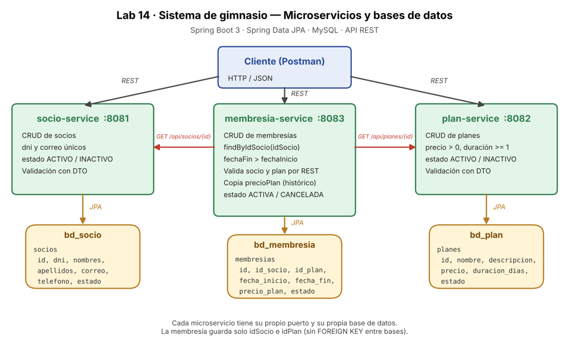

# Evaluación N.º 03 – Laboratorio 14: Sistema de gimnasio (Microservicios)

**Estudiante:** Maldonado Linares, Luis Miguel  
**Curso:** Desarrollo de Aplicaciones Web Avanzado · 4 C24 · Sección A – B  
**Docente:** Coello Palomino, Ricardo  
**Microservicios principales:** Socio, Plan, Membresía

Un gimnasio necesita gestionar socios, planes y membresías. Cada entidad vive en su propio microservicio con su propia base de datos; la membresía solo guarda `idSocio` e `idPlan` y consulta a los otros dos servicios por REST.



## Requisitos

| Herramienta | Versión |
|---|---|
| JDK | 17 o superior |
| Maven | 3.9+ (o usar el de IntelliJ/Eclipse) |
| MySQL | 8.x en `localhost:3306` |
| Postman | cualquier versión reciente |

## Microservicios, puertos y bases de datos

| Servicio | Puerto | Base de datos | Tabla |
|---|---|---|---|
| `socio-service` | 8081 | `bd_socio` | `socios` |
| `plan-service` | 8082 | `bd_plan` | `planes` |
| `membresia-service` | 8083 | `bd_membresia` | `membresias` |

## Estructura

```
lab14-gimnasio/
├── socio-service/        (model, dto, repository, services, controller, exception)
├── plan-service/         (model, dto, repository, services, controller, exception)
├── membresia-service/    (+ client, config)
├── scripts/              01_bd_socio.sql · 02_bd_plan.sql · 03_bd_membresia.sql
├── postman/              Lab14_Gimnasio.postman_collection.json
└── docs/                 diagrama de microservicios
```

## Pasos de ejecución

1. **Base de datos.** Ejecutar en MySQL, en orden, los scripts de `scripts/` (`01`, `02`, `03`). En perfil `dev` también se crean solas gracias a `createDatabaseIfNotExist=true` + `ddl-auto: update`.
2. **Contraseña de MySQL** (no se guarda en el código). Si tu usuario `root` tiene contraseña:
   - Windows (PowerShell): `$env:DB_PASSWORD="tu_clave"`
   - Linux/Mac: `export DB_PASSWORD=tu_clave`
3. **Levantar los servicios, en este orden**, cada uno en su propia terminal:
   ```bash
   cd socio-service      && mvn spring-boot:run
   cd plan-service       && mvn spring-boot:run
   cd membresia-service  && mvn spring-boot:run
   ```
4. **Probar** importando `postman/Lab14_Gimnasio.postman_collection.json` y ejecutando la colección completa con *Collection Runner* (todas las pruebas deben salir en verde).

## Perfiles `dev` / `prod`

Se configuran en `src/main/resources/application.yml` de cada servicio. El perfil por defecto es `dev`; para producción: `SPRING_PROFILES_ACTIVE=prod`.

| Valor | dev | prod |
|---|---|---|
| Conexión MySQL | `localhost`, `createDatabaseIfNotExist=true`, `useSSL=false` | `DB_URL` (variable de entorno), `useSSL=true` |
| Usuario / clave | `DB_USER` (por defecto `root`) / `DB_PASSWORD` (vacía) | `DB_USER` y `DB_PASSWORD` **obligatorias**, sin valor por defecto |
| `ddl-auto` | `update` (Hibernate crea/ajusta tablas) | `none` (el esquema viene de los scripts SQL) |
| `show-sql` | `true` | `false` |
| Logs `com.gimnasio` | `DEBUG` | `INFO` |
| URLs entre servicios (solo membresía) | `http://localhost:8081` y `:8082` | `SOCIO_SERVICE_URL` y `PLAN_SERVICE_URL` |

Ejemplo en prod:
```bash
export SPRING_PROFILES_ACTIVE=prod DB_USER=gym DB_PASSWORD=*** \
       DB_URL="jdbc:mysql://localhost:3306/bd_socio?useSSL=true&serverTimezone=America/Lima"
```

## Endpoints

### socio-service (8081)
| Método | Ruta | Descripción | Códigos |
|---|---|---|---|
| GET | `/api/socios` | Listar | 200 |
| GET | `/api/socios/{id}` | Buscar por ID | 200 / 404 |
| POST | `/api/socios` | Registrar | 201 / 400 / 409 |
| PUT | `/api/socios/{id}` | Actualizar | 200 / 400 / 404 / 409 |
| DELETE | `/api/socios/{id}` | Eliminar | 204 / 404 |

Cuerpo: `{"dni":"70112233","nombres":"Luis","apellidos":"Maldonado","correo":"luis@mail.com","telefono":"987654321","estado":"ACTIVO"}`  
Validaciones: DNI de 8 dígitos único, nombres/apellidos/correo obligatorios, correo con formato válido y único, teléfono opcional de 9 dígitos que empieza con 9.

### plan-service (8082)
| Método | Ruta | Descripción | Códigos |
|---|---|---|---|
| GET | `/api/planes` | Listar | 200 |
| GET | `/api/planes/{id}` | Buscar por ID | 200 / 404 |
| POST | `/api/planes` | Registrar | 201 / 400 / 409 |
| PUT | `/api/planes/{id}` | Actualizar | 200 / 400 / 404 / 409 |
| DELETE | `/api/planes/{id}` | Eliminar | 204 / 404 |

Cuerpo: `{"nombre":"Mensual","descripcion":"Acceso libre","precio":90.00,"duracionDias":30,"estado":"ACTIVO"}`  
Validaciones: nombre obligatorio y único, **precio mayor que 0**, duración de al menos 1 día.

### membresia-service (8083)
| Método | Ruta | Descripción | Códigos |
|---|---|---|---|
| GET | `/api/membresias` | Listar (simple) | 200 |
| GET | `/api/membresias/{id}` | Detalle con datos de socio y plan | 200 / 404 |
| GET | `/api/membresias/socio/{idSocio}` | Membresías de un socio (`findByIdSocio`) | 200 / 404 |
| POST | `/api/membresias` | Registrar | 201 / 400 / 404 / 503 |
| PUT | `/api/membresias/{id}` | Actualizar | 200 / 400 / 404 / 503 |
| PATCH | `/api/membresias/{id}/cancelar` | Cancelar | 200 / 400 / 404 |
| DELETE | `/api/membresias/{id}` | Eliminar | 204 / 404 |

Cuerpo: `{"idSocio":1,"idPlan":1,"fechaInicio":"2026-11-10","fechaFin":"2026-12-10"}`  
Reglas: `fechaFin` posterior a `fechaInicio`; el socio debe existir y estar `ACTIVO`; el plan debe existir, estar `ACTIVO` y tener precio > 0. El precio del plan se copia a `precioPlan` al registrar.

### Formato de error (todos los servicios)
```json
{
  "timestamp": "2026-11-06T10:15:30",
  "status": 400,
  "error": "Bad Request",
  "message": "Datos de entrada inválidos",
  "path": "/api/socios",
  "details": { "dni": "El DNI debe tener exactamente 8 dígitos" }
}
```

## Prueba de aceptación (Postman)
Registrar socio → registrar plan → registrar membresía → consultar membresías por socio → actualizar → cancelar. Casos de error cubiertos: DNI duplicado (409), datos inválidos (400), precio negativo (400), fechas incorrectas (400), socio/plan/membresía inexistente (404).
